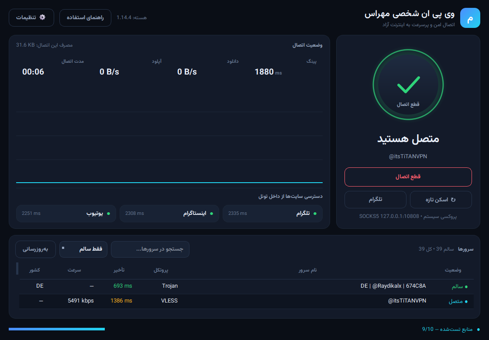

# وی پی ان شخصی مهراس
### Mehras VPN — کلاینت شخصی عبور از فیلترینگ برای ویندوز


-22d3ee)

مهراس یک فیلترشکن کامل و «خودکار» است: خودش گره‌ها را از منابع زنده می‌گیرد،
با **اتصال واقعی از داخل تونل** تست می‌کند، بهترین را انتخاب می‌کند و اگر گره
ضعیف یا مرده شد، خودکار جایگزین می‌کند. لازم نیست حتی یک کانفیگ دستی وارد کنید.

<p align="center">
  
</p>

<p align="center">
  <a href="docs/راهنمای-مهراس.pdf">📘 راهنمای PDF</a> •
  <a href="../../issues/new/choose">🐞 گزارش باگ</a> •
  <a href="../../discussions">💬 گفتگو</a> •
  <a href="CHANGELOG.md">📋 تغییرات</a>
</p>

---

## چه چیزی در نسخه ۲ عوض شد؟

نسخه‌ی قبلی (که کار نمی‌کرد) این مشکلات را داشت: از هسته‌ی قدیمی Xray استفاده
می‌کرد، ده‌ها هزار گره‌ی مرده را دانلود می‌کرد، برای هر گره یک پروسه‌ی جدا
بالا می‌آورد (کند و شکننده)، تقریباً همیشه ۰ تا ۱ گره‌ی سالم پیدا می‌کرد و
رابط کاربری «فضایی» آن عملاً غیرقابل استفاده بود.

| موضوع | نسخه قدیم | نسخه ۲ (این نسخه) |
|---|---|---|
| هسته | Xray 24.9 | **sing-box 1.14** (پشتیبان REALITY، Hysteria2، TUIC، AnyTLS) |
| تست هر گره | یک پروسه‌ی جدا (۳–۹ ثانیه) | **یک پروسه برای هر دسته‌ی ۲۴ گره‌ای** (~۴ ثانیه برای کل دسته) |
| نتیجه‌ی تست (اندازه‌گیری‌شده) | ۱ گره سالم از ۴۰ | **۲۰ گره سالم از ۱۰۱** (تأیید دو مقصد + سه سایت هدف) |
| منابع | ۱۴ منبع، بعضی ۴۰۴ و مرده | منابع **زنده‌تست‌شده در ۲۰۲۶-۱۰-۲۶** + گره‌های از پیش تست‌شده |
| تأیید اتصال | فقط «پروسه بالا آمد» | **آزمون تلگرام/اینستاگرام/یوتیوب از داخل تونل؛ اگر یکی باز نشود گره عوض می‌شود** |
| پایش سلامت | هر ۲۰ دقیقه | هر ۲۰ ثانیه + جایگزینی خودکار |
| پینگ سایت‌های هدف | تست نمی‌شد | تلگرام/اینستاگرام/یوتیوب **از داخل تونل** تست و نمایش داده می‌شوند |
| کل سیستم (تلگرام) | فقط پروکسی مرورگر | **حالت TUN** + راهنمای تنظیم SOCKS5 تلگرام |
| رابط کاربری | شیشه‌ای/ستاره‌ای و شلوغ | داشبورد ساده، تیره، راست‌به‌چپ با نمودار سرعت زنده |

---

## نصب و اجرا

نیازمندی: ویندوز ۱۰/۱۱، پایتون ۳.۱۰ یا بالاتر.

```bat
git clone https://github.com/Jamilazimi/mehras-vpn.git
cd mehras-vpn
run.bat
```

یا اگر فقط فایل‌ها را دانلود کرده‌اید:

```bat
pip install -r requirements.txt
python main.py
```

در اولین اجرا، هسته‌ی sing-box (و درایور `wintun.dll` برای حالت TUN) به‌طور
خودکار دانلود می‌شود. اگر GitHub در دسترس نبود، از آینه‌های جایگزین
(`gh-proxy.com`، `gh.llkk.cc`، `ghfast.top`) استفاده می‌شود.

> پس از اولین اسکن، فهرست گره‌های سالم در `data/working_cache.json` ذخیره
> می‌شود (این فایل در مخزن نیست) و اجراهای بعدی در چند ثانیه وصل می‌شوند.

---

## استفاده در سه گام

1. **دکمه‌ی بزرگ وسط** را بزنید. برنامه منابع را می‌گیرد، پورت‌ها را بررسی
   می‌کند، چند صد گره را با تونل واقعی تست می‌کند و به بهترین وصل می‌شود.
   اتصال اول معمولاً **۲۰ تا ۶۰ ثانیه** طول می‌کشد (یک دور سریع، سپس اسکن
   کامل در پس‌زمینه)؛ اجراهای بعدی چند ثانیه (از حافظه).
2. **مرورگر** خود را باز کنید؛ با روشن بودن «پروکسی سیستم»، اینستاگرام و
   یوتیوب و بقیه‌ی سایت‌ها خودکار عبور می‌کنند.
3. **تلگرام دسکتاپ**: دکمه‌ی «تلگرام» در صفحه‌ی اصلی را بزنید؛ آدرس پروکسی
   با یک کلیک کپی می‌شود. سپس در تلگرام:
   `Settings → Advanced → Connection type → TCP with custom proxy`
   با نوع `SOCKS5`، میزبان `127.0.0.1` و پورت `10808`.

### اشتراک شخصی (توصیه‌ی مهم)

اگر اشتراک خریداری‌شده یا کانفیگ شخصی دارید، در
`تنظیمات ← اشتراک یا کانفیگ شخصی` هر خط یک آدرس `https://…` یا لینک
`vless://`/`trojan://`/`ss://`/`hysteria2://` وارد کنید. این گره‌ها **اول
از همه** تست می‌شوند و امتیاز بالاتری می‌گیرند (پایدارتر از گره‌های عمومی).

> برای عبور **کل سیستم** (تلگرام، دیسکورد، بازی، هر برنامه‌ای) از
> `تنظیمات → حالت اتصال → حالت کامل TUN` استفاده کنید. ویندوز یک بار اجازه‌ی
> مدیر می‌خواهد؛ اگر اجازه نداده شود، برنامه خودکار به حالت پروکسی برمی‌گردد.

راهنمای کامل و تصویری: **[docs/راهنمای-مهراس.pdf](docs/راهنمای-مهراس.pdf)**

---

## چه چیزی روی صفحه می‌بینید؟

- **حلقه‌ی وسط**: سبز = متصل، زرد = در حال اتصال/جستجو، خاکستری = قطع.
- **کارت وضعیت**: پینگ واقعی تونل، سرعت دانلود/آپلود زنده (از Clash API خود
  هسته)، مدت اتصال و حجم مصرف‌شده.
- **نمودار سرعت**: ۹۰ نمونه‌ی آخر (هر ۲ ثانیه).
- **دسترسی سایت‌ها**: سه نشان تلگرام/اینستاگرام/یوتیوب که از داخل تونل تست
  می‌شوند، نه از بیرون.
- **جدول سرورها**: کشور، نام، پروتکل، تأخیر، سرعت و وضعیت. دوبار کلیک = اتصال.

---

## چطور کار می‌کند (معماری)

```
app/
  config.py            منابع زنده‌تست‌شده، پیش‌فرض‌ها، مسیرها
  core/
    parser.py          تجزیه vmess/vless/trojan/ss/hysteria2/tuic/anytls → outbound sing-box
    sources.py         دریافت موازی اشتراک‌ها + پشتیبانی base64/JSON + حذف تکراری
    engine.py          نصب و مدیریت هسته، ساخت کانفیگ (mixed + TUN + مسیر ایران مستقیم)
    probe.py           پیش‌فیلتر TCP + تست دسته‌ای تونل + تست سرعت + تست سایت‌های هدف
    selector.py        امتیازدهی، کش گره‌های سالم، سلامت منابع
    vpn.py             کنترلر: اسکن مرحله‌ای، اتصال، پایش سلامت، جایگزینی خودکار
  ui/
    theme.py           سیستم طراحی و QSS
    widgets.py         دکمه‌ی قدرت، کارت آمار، نشان سایت، نمودار سرعت
    main_window.py     داشبورد اصلی
  utils/
    system_proxy.py    پروکسی ویندوز با پشتیبان‌گیری و بازگردانی
    logger.py          لاگ چرخشی
tools/
  selftest.py          تست پذیرش کامل (headless)
  controller_test.py   تست یکپارچه‌ی کنترلر با سیگنال‌ها
  screenshot.py        تصویر از رابط کاربری (--live برای اجرای واقعی)
  build_guide_docx.py  ساخت راهنمای PDF/Word
```

### چرا تست دسته‌ای سریع است؟

برای هر دسته ۲۴ گره، **یک** پروسه‌ی sing-box اجرا می‌شود که ۲۴ inbound
(SOCKS روی پورت‌های محلی) و ۲۴ outbound دارد؛ ترافیک هر inbound با یک قاعده‌ی
مسیریابی به outbound خودش می‌رود. سپس هر ۲۴ گره هم‌زمان از داخل تونل تست
می‌شوند. اگر یک گره کانفیگ خراب داشته باشد، هسته پیام `initialize outbound[i]`
می‌دهد و همان گره حذف و دسته دوباره اجرا می‌شود.

نکته‌ی مهم: اسکن با تعداد اتصال معتدل (۴۸ worker) انجام می‌شود؛ اسکن پرهیاهو
باعث می‌شود ISP موقتاً اتصال‌ها را drop کند و نتیجه از واقعیت بدتر شود.

---

## منابع گره

منابع در `app/config.py` هستند و همگی در تاریخ **۲۰۲۶-۱۰-۲۶** زنده تست شدند.
منابع ۴۰۴ قدیمی حذف و منابع فعال (که با جست‌وجوی مخازن به‌روز پیدا شدند) اضافه
شدند. اولویت با منابعی است که گره‌هایشان از پیش تست شده‌اند:

- `RichTiTAN/V2rayTested` — گره‌های تست‌شده (بالاترین نرخ موفقیت)
- `0xRadikal/Free-v2ray-Configs` — top100 و verified
- `mahdibland/V2RayAggregator`, `roosterkid/openproxylist`, `MatinGhanbari`,
  `barry-far`, `ermaozi`
- منابع حجیم: `mheidari98/.proxy`, `Epodonios`, `Surfboardv2ray/TGParse`,
  `MohammadBahemmat`, `MahanKenway`, `Danialsamadi`, `Alirewa`, `kasesm`,
  `nyeinkokoaung404`, `Delta-Kronecker`

نرخ «زنده‌بودن واقعی» هر منبع در `data/source_health.json` ذخیره می‌شود و در
اسکن‌های بعدی، منابع پربازده اول بررسی می‌شوند.

---

## نتایج تست واقعی (تست پذیرش)

اجرای `python tools/selftest.py` روی همین شبکه (۲۰۲۶-۱۰-۲۶):

```
989 گره یکتا از منابع تست‌شده در ۱.۳ ثانیه
101 گره با پورت باز (۴۵ ثانیه)
20 گره سالم از 101 تست‌شده (۵۳ ثانیه)   ← با تأیید دو مقصد + آزمون سه سایت
گره اول یکی از سایت‌ها را باز نکرد → خودکار گره بعدی
اتصال: ss <node-ip> — ۷۹۱ms
تلگرام OK   (302)
اینستاگرام OK (200)
یوتیوب OK   (204)
```

در اجراهای دیگر همان روز، ۲۳ تا ۴۰ گره سالم از ~۱۲۰ گره پیدا شد و سرعت
دانلود تا ~۹٫۴Mbps رسید. عدد دقیق هر ساعت و هر شبکه متفاوت است؛ گره‌های
عمومی رایگان‌اند و شبکه‌ی ایران نوسان زیادی دارد. به همین دلیل برنامه
**کش تجمعی** (گره‌های سالم قبلی حفظ می‌شوند)، اسکن دوره‌ای، آزمون مجدد
گره‌های شکست‌خورده و جایگزینی خودکار دارد.

معیارهای انتخاب گره، به‌ترتیب اهمیت: باز شدن هر سه سایت هدف (تلگرام،
اینستاگرام، یوتیوب)، تأیید از دو مقصد مستقل، تأخیر، و سرعت دانلود.

---

## عیب‌یابی

| نشانه | راه‌حل |
|---|---|
| «هیچ گره‌ی سالمی پیدا نشد» | اینترنت را بررسی کنید و چند دقیقه بعد «اسکن گره‌های تازه» را بزنید |
| سایت باز نمی‌شود ولی برنامه «متصل» است | «اعمال خودکار پروکسی روی ویندوز» را روشن کنید و مرورگر را ری‌استارت کنید |
| تلگرام وصل نمی‌شود | بخش تنظیم SOCKS5 بالا را انجام دهید یا حالت TUN را فعال کنید |
| سایت بانکی باز نمی‌شود | «سایت‌های ایرانی مستقیم» را روشن کنید |
| حالت TUN فعال نمی‌شود | برنامه را با Run as administrator اجرا کنید |
| قطعی هر چند دقیقه | «جابه‌جایی خودکار به گره‌ی بهتر» را روشن بگذارید |

لاگ‌ها: `data/logs/app.log` (برنامه)، `data/logs/singbox.log` (هسته)،
`data/logs/startup_error.log` (خطای راه‌اندازی).

---

## ابزارهای توسعه

```bat
python tools/selftest.py                  :: تست پذیرش کامل
python tools/selftest.py --limit 60      :: سریع‌تر
python tools/controller_test.py --fresh  :: تست کنترلر و اتصال واقعی
python tools/screenshot.py assets/out.png --live
python tools/build_guide_docx.py         :: بازسازی راهنما
```

---

## حریم خصوصی

- هیچ داده‌ای به سرور شخصی فرستاده نمی‌شود؛ آمار مصرف فقط محلی ذخیره می‌شود.
- تنظیمات پروکسی قبلی ویندوز ذخیره و هنگام قطع بازگردانده می‌شود.
- کانفیگ‌ها از مخازن عمومی می‌آیند؛ برای اطلاعات حساس روی گره‌های عمومی
  حساب ویژه باز نکنید.

---

## مشارکت و بازخورد

هر کسی می‌تواند استفاده کند، باگ بفرستد یا بهترش کند:

1. ⭐ اگر به کارت آمد، ستاره بده تا بقیه هم پیدا کنند.
2. 🐞 برای باگ، از [قالب گزارش باگ](../../issues/new/choose) استفاده کن و
   لاگ‌ها را پیوست کن.
3. 💡 برای ایده و پرسش، [Discussions](../../discussions) را ببین.
4. 🔧 برای تغییر کد، [CONTRIBUTING.md](CONTRIBUTING.md) را بخوان.

```bat
git clone https://github.com/Jamilazimi/mehras-vpn.git
cd mehras-vpn
git checkout -b fix/my-change
python tools/selftest.py --limit 60
git commit -am "fix: ..." && git push -u origin fix/my-change
```

اگر اشتراک شخصی‌ات را در `data/custom_sources.json` گذاشته‌ای، آن فایل در
مخزن commit نمی‌شود (`.gitignore`) — همان‌طور که `working_cache.json` و لاگ‌ها
هم خارج از مخزن می‌مانند.

---

## ساختار مخزن

```
mehras-vpn/
├─ main.py                  نقطه‌ی ورود
├─ app/                     منطق برنامه (core/ و ui/ و utils/)
├─ tools/                   اسکریپت‌های تست، تصویر و ساخت راهنما
├─ docs/                    راهنمای PDF و منبع Word
├─ assets/                  آیکون و تصویر رابط کاربری
├─ fonts/                   فونت وزیرمتن (OFL)
├─ .github/                 قالب Issue و Pull Request
├─ LICENSE · NOTICE.md · CONTRIBUTING.md · CHANGELOG.md
└─ data/                    (خارج از مخزن) هسته، کش، تنظیمات و لاگ‌ها
```

---

## مجوز

کد این پروژه با [MIT](LICENSE) منتشر می‌شود.
هسته‌ی sing-box (GPL-3.0)، درایور wintun و فونت وزیرمتن (OFL) مجوزهای خودشان
را دارند؛ جزئیات در [NOTICE.md](NOTICE.md).

## سلب مسئولیت

این نرم‌افزار برای دسترسی به اینترنت آزاد و استفاده‌ی شخصی/آموزشی نوشته شده
است. گره‌هایی که استفاده می‌شود عمومی و متعلق به دیگران‌اند و هیچ تضمینی برای
پایداری، امنیت یا سرعت آن‌ها وجود ندارد. مسئولیت رعایت قوانین محل زندگی خود
و رعایت حقوق سرویس‌دهندگان، بر عهده‌ی کاربر است. هیچ داده‌ای جمع‌آوری یا
فروخته نمی‌شود.
